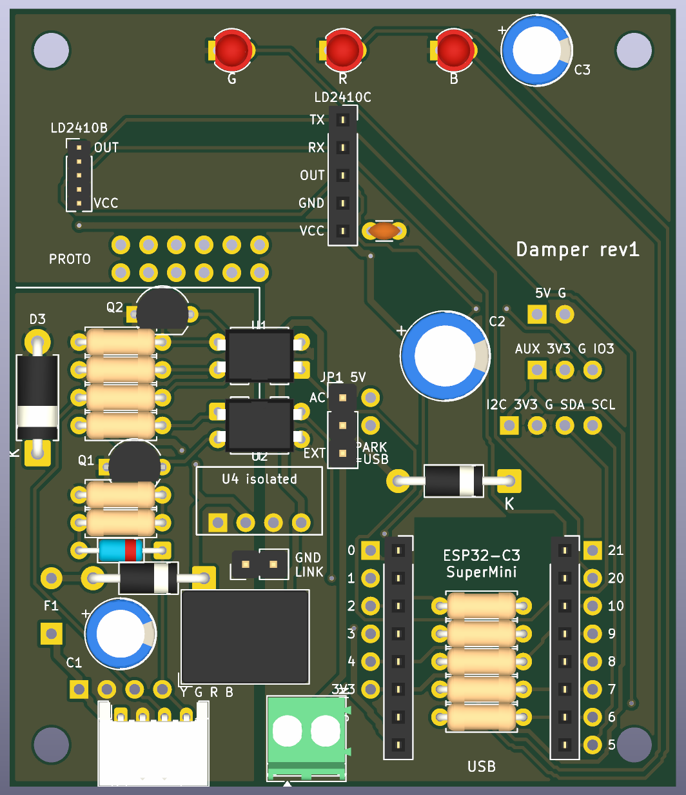
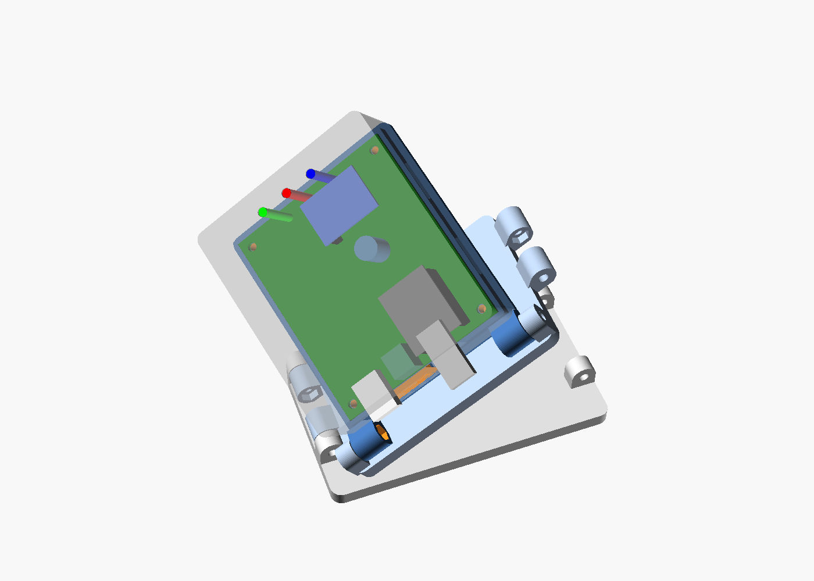

# Damper controller hardware: PCB and two-axis wall case

Rev 1. A 61 x 71 mm two-layer, all through-hole board for a socketed ESP32-C3 SuperMini and an LD2410 radar, and a printed case whose wall mount aims it up/down and left/right.

Nothing here has been built yet. The board passes KiCad's design-rule check and the firmware config validates, but no board has been made, no part printed, and the two optocoupler stages have not been tried against a real damper.




## Do not order before these checks

| # | Check | Why |
|---|-------|-----|
| 1 | Build the control and state stages (see Circuit) on a breadboard and try them on the damper | They replace the divider and bare transistor that are known to work. Component values come from the measurements below, not from a test. |
| 2 | Print `pcb/damper-1to1.pdf` at 100 % and press the real SuperMini, LD2410, JST header, regulator and screw terminal onto the paper | Footprints come from KiCad's library and from caliper photos, not from parts in hand. |
| 3 | Read the pin names printed on your LD2410C and compare with J7: TX, RX, OUT, GND, VCC from the top | The order is from the datasheet as remembered. If it is reversed the module still fits: it then lies to the other side of J7. If it is different, edit `RADAR_C` in `pcb/gen_pcb.py`. |
| 4 | With the board bare, plug the wall cable into J1 and confirm yellow lands on the pin marked Y | Yellow = pin 1 was read from a photo of the original board. |
| 5 | Measure the height of the SuperMini's USB-C socket above the PCB once it sits in its sockets | `usb_z` and `stack_h` in `case/case.scad` assume 13.6 mm and 18 mm. |

## Measurements

Taken on the wall cable with the original controller unplugged, unless noted. Same results in two rooms.

### Connector

JST PH, 2.0 mm pitch, 4 positions. Female housing on the wall cable, male header on the controller.

| Pin | Wire | Function |
|-----|------|----------|
| 1 | Yellow | 12 V |
| 2 | Green | GND |
| 3 | Red | Control, pulled low to toggle |
| 4 | Black | State |

Order as seen with the housing's key facing you, left to right: yellow, green, red, black. On the original board yellow sits on the square pad. A bought JST PH pigtail may use other colours (the one used for measuring has white in place of green).

### Voltages

| Line | Condition | Open circuit | With 10 k to GND |
|------|-----------|--------------|------------------|
| Red (control) | idle | 5.15 V | 5.10 V |
| Black (state) | damper closed | 12.07 V | 11.95 V |
| Black (state) | damper open | 0 V | 0 V |
| Black (state) | damper open, original controller connected | 2.5 V | - |
| Yellow (12 V) | no load | 12.09 V | 11.97 V |
| Yellow (12 V) | powering the ESP32-S3 (N16R8 dev board) through a buck converter | 11.55 V | - |

What they say:

- **Control** has about 100 ohm behind it, so pulling it low takes tens of mA. The original button pulls it to 1-2 V, not to 0.
- **State** is stiff at 12 V when closed. When open it reads 0 V on a bare cable and 2.5 V with the original controller attached, so the 2.5 V comes from the controller's own circuit. The detector's threshold of about 6 V handles both.
- **12 V** drops 0.54 V under an ESP32-S3. It can power the board, but there is not much to spare.

Short-circuit currents were also read with the meter on its 20 mA range: red to green 0, black to green 0, yellow to green 0.83 mA. They contradict the voltage readings above and are not used. Do not repeat them: shorting the 12 V line through a meter is a dead short.

### Parts

| Part | Measured |
|------|----------|
| ESP32-C3 SuperMini (HW-466AB) | about 18 x 22.5 mm, two rows of 8 pins |
| HLK-LD2410C V1.1 | about 16 mm across the edge with the 5-pin 2.54 mm header |
| HLK-LD2410B | about 7 mm wide, five 1.27 mm pads on one short end |

Read from caliper photos, good to about half a millimetre.

## Files

| File | What it is |
|------|------------|
| `pcb/gerbers/damper-rev1.zip` | Gerbers and drill files. Upload to PCBWay: 2 layers, 1.6 mm, any colour, lead-free HASL. |
| `pcb/damper.kicad_pcb` | The board, opens in KiCad 9 or newer. |
| `pcb/gen_pcb.py` | Generates the board. There is no schematic; the netlist is the part tables in this script, and it routes the tracks itself. |
| `pcb/export.ps1` | Runs the generator, the design-rule check, and writes the Gerbers and the PDF. |
| `pcb/damper-1to1.pdf` | Pads, silkscreen and outline at 1:1 for the paper check. |
| `pcb/bom.csv` | Parts list, written by the generator. |
| `case/case.scad` | Parametric case (OpenSCAD). |
| `case/body.stl`, `cover.stl`, `swing-plate.stl`, `wall-plate.stl` | Printable parts, already in print orientation. |
| `../damper_board.yaml` | ESPHome config for this board. |

After editing `gen_pcb.py`:

```
pwsh hardware/pcb/export.ps1
```

The design-rule check in that script ignores courtyard overlaps: the axial resistors sit on a 2.54 mm pitch, closer than KiCad's courtyards allow, which is tight but fits 1/4 W parts.

## Circuit

Two grounds: `AC_GND` on the damper side (bottom-left block of the board, outlined on the silkscreen) and `GND` on the ESP side. Only U1, U2, the regulator and the jumper JP2 cross the 1 mm gap between them.

```
 DAMPER SIDE (AC_GND)                    |  ESP SIDE (GND)
                                         |
 12V --F1 PTC--D2 1N5819--+--C1 100uF    |
                 D3 TVS 15V to AC_GND    |
                          +--> U3 or U4 --> 5V_REG
                                         |
 12V --R5 4k7--> U1 collector            |  GPIO0 --R1 220R--> U1 LED --> GND
 U1 emitter --+-- Q2 base, R6 10k to AC_GND
 CTRL (red) --R7 33R-- Q2 collector      |
              Q2 emitter -> AC_GND       |
                                         |
 STATE (black) --ZD1 5V1--R8 10k--+-- Q1 base, R9 10k to AC_GND
 12V --R10 2k2--> U2 LED --> Q1 collector|  3V3 --R2 10k--+-- GPIO1
                  Q1 emitter -> AC_GND   |                U2 collector, emitter GND
```

- **Control:** the optocoupler U1 turns on Q2, which pulls the red wire down through R7. 33 ohm limits the current to about 40 mA and leaves the line near 1.3 V, like the original button. If the damper does not react, replace R7 with a wire link; that is what the prototype's transistor does.
- **State:** the zener sets a threshold near 6 V. Below it Q1 is off; at 12 V Q1 lights U2's LED from the 12 V rail. The state wire itself supplies only about 0.6 mA, less than the prototype's divider.
- **Logic:** a closed damper reads low on GPIO1, an open one high. An unplugged cable reads "open". This is the opposite of the prototype, hence `damper_state_inverted: "false"` in `damper_board.yaml`.
- **12 V input:** resettable fuse F1, reverse-polarity diode D2, TVS diode D3.

### 12 V to 5 V: fit U3 or U4, never both

| Fit | Part | JP2 "GND LINK" | Result |
|-----|------|----------------|--------|
| U3 (recommended) | K7805-1000R3 or R-78E5.0-1.0, fixed 5 V switching regulator | on | Same arrangement as the working prototype. The grounds are joined; the control and state wires are still buffered by the optocouplers. |
| U4 | B1205S-1W, isolated 12 V to 5 V, SIP-4 | off | The two sides share no conductor. Limits: 200 mA, which is enough for the ESP alone and tight with the radar; and it wants 10.8-13.2 V in, while the line was measured at 11.55 V under a comparable load. |

The U4 footprint is four pads on a 2.54 mm pitch in the order -Vin, +Vin, -Vout, +Vout. Check the datasheet of the part you buy.

With U3 fitted, pulling JP2 while powering from USB or from J2 isolates the ESP from the damper completely.

### Power select, JP1

| Jumper | Source |
|--------|--------|
| `AC` (top two pins) | 5 V from U3/U4, fed by the damper's 12 V |
| `EXT` (bottom two pins) | 5 V from the screw terminal J2 |
| parked on JP3 | none: USB-C on the ESP |

D1 (1N5817) follows the jumper so USB cannot feed back into the regulator or J2. It costs about 0.3 V, so the 5 V rail sits near 4.7 V. If the radar misbehaves, replace D1 with a wire link and never plug USB in while the jumper is on `AC` or `EXT`.

### ESP32-C3 SuperMini

Plugs into two 1x8 sockets (J3, J4), USB-C towards the bottom edge. There is no copper under its antenna.

| GPIO | Use |
|------|-----|
| 0 | Damper trigger |
| 1 | Damper state |
| 6, 7 | Green, red LED: damper open / closed |
| 10 | Blue LED: for Home Assistant to drive, for example the AC's state |
| 20, 21 | Radar UART (ESP RX, ESP TX) |
| 3 | Radar OUT, also on the AUX header |
| 4, 5 | I2C header (SDA, SCL) |
| 2, 8, 9 | Free. 2, 8 and 9 are strapping pins; 8 is the onboard LED, 9 the BOOT button |

### Spare holes

- **J5, J6:** the ESP's pins, 1:1, beside each socket. 5V and GND are not in J5 (the screw terminal is in the way); take them from J11.
- **J9 I2C:** 3V3, GND, SDA (GPIO4), SCL (GPIO5).
- **J10 AUX:** 3V3, GND, GPIO3. For an IR receiver or a button.
- **J11:** 5 V, GND.
- **J1B:** the four damper wires again on a 2.54 mm pitch, for a soldered pigtail in place of the JST header.
- **PROTO:** twelve unconnected pads.

### Radar

- **LD2410C:** solder its pin header so the antenna side faces away from the board, and plug it into J7. It lies flat, to the left or to the right of J7 depending on which end its pin 1 is. Both areas are kept free of tall parts; the parts underneath are lower than the socket.
- **LD2410B:** J8 has its five signals on a 1.27 mm pitch (OUT, TX, RX, GND, VCC from the top). Wire it with a short cable, or stand it on a 1.27 mm header.

Solder the three LEDs standing tall, so their domes reach the holes in the cover.

## Case

About 69 x 79 mm and 28 mm deep; the wall plate is 101 x 56 mm and the mount adds 10 mm behind the case. PLA or PETG, 0.2 mm layers, no supports. Hardware: four M3 x 20 screws with nuts, four M3 x 6, two wall screws.

The mount has two axes, so the radar can look across a room from an upper corner:

- **Wall plate:** two screws into the wall, 48 mm apart, heads sunk into the plate. The wall cable comes through the opening in the middle. It has hinge lugs on both side edges.
- **Swing plate, left/right:** sits on the wall plate and opens like a door, 0 to 90 degrees. Fit two M3 x 20 screws and nuts on **one** side only: hinge it on the side that faces the room, so the edge nearest the corner swings away from the wall. The nuts sit in the hex pockets on the inner ends of the swing plate's knuckles. The upper screw goes in from above, so set its friction before hanging the unit near a ceiling; the lower one stays reachable from below.
- **Tilt hinge, up/down:** an M3 x 20 screw and nut on each side, through the swing plate's lug into the body's knuckle; the nut sits in the hex pocket on the knuckle's inner end. Tilt the case forward until the radar looks where you want, then tighten. Flat is 0 degrees; about 45 degrees is the useful limit. To tilt upward instead, mount everything upside down.
- **Order of assembly:** join the two plates with the pan screws, screw the wall plate to the wall through the two access holes in the swing plate, then hang the body on the tilt screws.
- **Body:** the PCB sits on four posts, M3 x 6 screws. Without the mount, the body hangs flat on two screws through the keyholes in its back.
- **Cover:** snaps over the body's lip. The bottom wall has one wide notch for the JST plug and the 5 V cable, open towards the rim so the cover goes on with cables plugged, and a window for USB-C. Three holes for the LEDs, and a thinner patch over the SuperMini so its own LED glows through. The face over the radar is closed, 1.2 mm thick.

Not checked on real hardware: the snap fit (`snap`, `lip_gap`), whether the two hinges hold their angles by friction alone, and the USB window height. The model was checked for collisions between the mount and the case over the whole pan and tilt range (`part="clash"` in `case.scad` must render empty). Expect one test print.

## Firmware

`damper_board.yaml` in the repository root. It validates with `esphome config`; it has not been compiled or flashed.

The radar package (`presence_package.yaml`) is on the `feature/presence-sensor` branch. Once that is merged, uncomment the `presence:` line in `damper_board.yaml`; the UART pins are already set.
